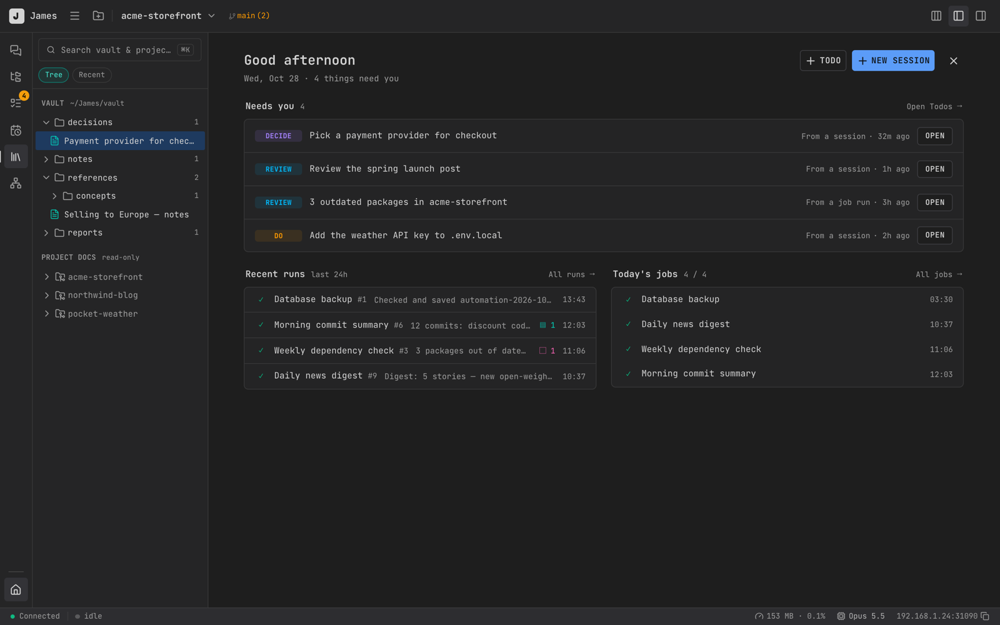

# Getting Started

## Requirements

- macOS 11 or later (Apple Silicon)
- [Claude Code](https://docs.anthropic.com/claude-code) CLI installed and logged in

## Install

1. Download the `.dmg` from the [latest release](https://github.com/yahoai/james-releases/releases/latest).
2. Open it and drag **James** into **Applications**.
3. Open James from Applications. Builds are signed and notarized by Apple, so it opens without warnings.

## Your first session

1. Click **Add Project** (⌘⇧O) and choose a folder with your code.
2. Press **⌘K**, pick the project, and start a session.
3. Type what you want Claude to do and press Enter.

**Home** shows what needs you, recent job runs and today's jobs.

Next, see [Sessions & Chat](./sessions.md) for split view, permission modes and more, or [Remote & Mobile](./mobile.md) to use James from your phone.

## Updates

James checks for updates automatically and installs them for you.
