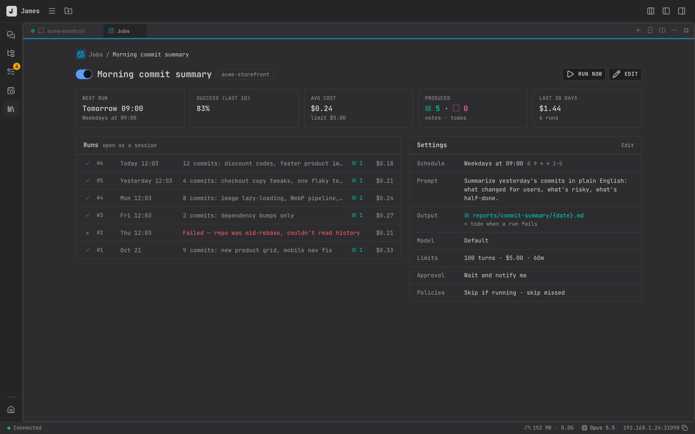
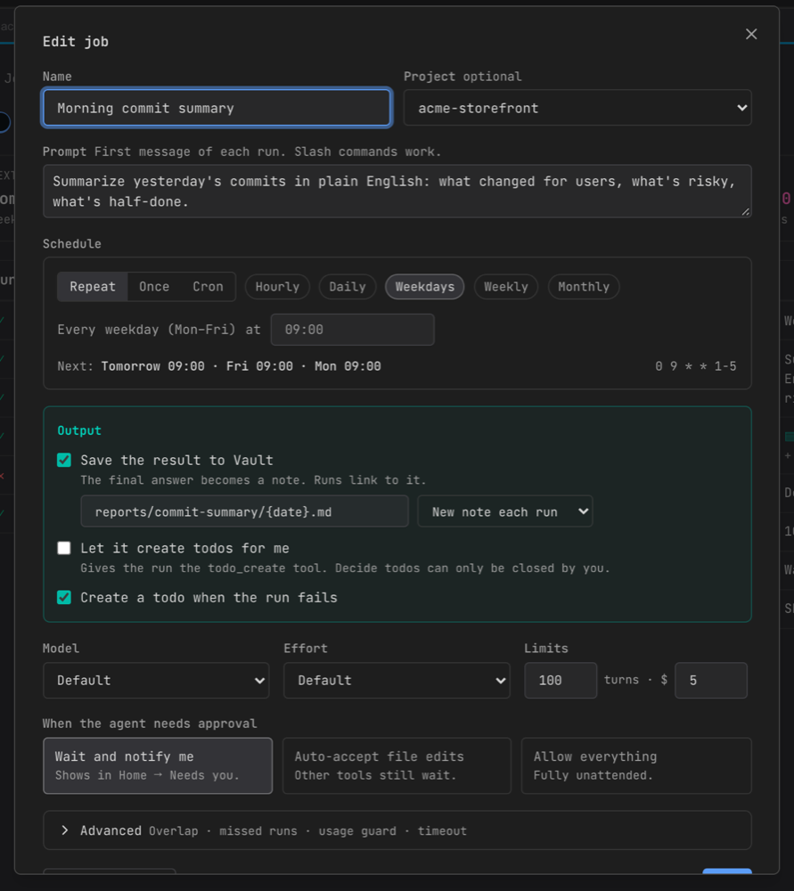

# Jobs & Runs

A **job** is a prompt that James runs on a schedule, like "every weekday at 9am, summarize yesterday's commits", "every Sunday, check for dependency updates". Each time it runs, that's a **run**: a new session that works on its own and reports back.

Open it from the **Jobs** icon in the sidebar, or **More → Jobs** on mobile. James must be running for jobs to run.

## Create a job

The easiest way is **Create with AI**: pick a project and describe what you want. Claude asks what it needs and sets the job up for you.

To fill in the form yourself, use **⋯ → Create manually…**:

- **Name** and **Project**: the job runs in that project's folder. With no project, it runs in your Vault folder.
- **Prompt**: the first message of each run. Slash commands work.
- **Schedule**
  - **Repeat**: hourly, daily, weekdays, weekly or monthly, at a time you choose
  - **Once**: a single date and time
  - **Cron**: a 5-field cron expression in any time zone

  The next three run times are shown so you can check it.
- **Output**
  - **Save the result to Vault**: a new note each run, or append to one note
  - **Let it create todos for me**
  - **Create a todo when the run fails**
- **Model**, **Effort**, and **Limits**: max turns (default 100) and max cost (default $5) per run.
- **When the agent needs approval**
  - **Wait and notify me**: the run pauses and shows up in Home → Needs you
  - **Auto-accept file edits**
  - **Allow everything**

Under **Advanced** you can choose what happens if the previous run is still going, whether to catch up on a run missed while James was closed, skip runs when your 5-hour usage is above a limit, and set a timeout (default 60 minutes).

Use **Test run now** to try the job before saving.

## Runs

The **Runs** tab lists every run with its trigger, duration, cost, what it produced (notes, todos) and result: Running, Waiting for you, Completed, Failed, Skipped or Stopped.

Opening a run opens its session, so you can read exactly what happened or keep the conversation going. From there, **Run again** repeats it.

A job's page shows its next run, success rate over the last 10 runs, average cost and recent runs.

James keeps the newest 100 runs of each job. Older runs are removed after 90 days.

## Controls

- The toggle on each job pauses or resumes it. **Run now** runs it immediately; **Stop run** stops a running one.
- **Pause all** pauses every job for an hour, 4 hours, until tomorrow morning, or until you resume.
- Deleting a job removes it and its run history. Sessions from past runs stay in your session list.

A built-in **Database backup** job runs daily at 03:30. You can turn it off or change its time, but not delete it.

## Getting results

- Every run gets a one-line summary and cost.
- Results can be saved to the [Vault](./vault.md) and raise [Todos](./todos.md).
- Failed runs appear under **Needs you** on Home and send a push notification ("Job run failed").
- Home shows **Today's jobs** and **Recent runs**.

## Asking Claude

You can manage jobs from any session:

> "Every Monday at 8am, check this repo for outdated dependencies and put a summary in my inbox."
>
> "Pause the nightly report job until Friday."
>
> "Why did last night's run fail?"

## Routines plugin

The `james-routines` plugin lets you keep job definitions as files in your repo (`.workflow/routines/`) and register them as James jobs. See [Plugins & Extensions](./plugins.md#james-routines).
