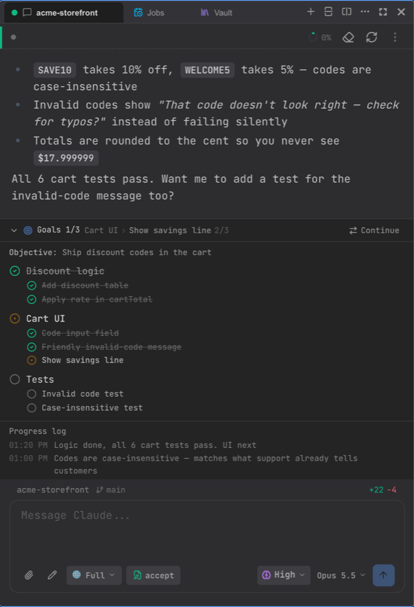

# Sessions & Chat

A session is one Claude Code conversation in one project. You can run as many as you like at the same time, side by side.

## Starting a session

Press **⌘K** (or click **New session** at the top of a pane) and pick a project. Recent projects come first; you can search, or pick **No project (Scratch)** for a throwaway folder that's deleted with the session.

If you have James on more than one Mac, the **Machine** picker lets you start the session on another Mac — see [Remote & Mobile](./mobile.md#use-another-mac-peers).

To pick up an older Claude Code conversation in this project, use the session ⋮ menu → **Resume Past Session**.

## Workspaces and the sidebar

The sidebar groups projects into **workspaces** (for example "Work" and "Personal"). Use **Add Workspace** in the sidebar to create one, and a project's menu → **Move to workspace…** to file it. Each project lists its sessions underneath.

## Split view

Use **Split right** and **Split down** at the top of a pane to put sessions side by side. Right-click a tab to move it to a new pane or another group. The pane menu's **Layout** options resize panes (Equal, Focus this, Expand this…).

Right-click a tab and choose **Hide (keep running)** to get it out of the way without stopping it.

## The message toolbar

Under the message box:

- **Permission mode** — how much Claude may do without asking. **Shift+Tab** cycles through them.
  - **Default** — prompts for risky actions
  - **Accept** — auto-approves file edits
  - **Plan** — read-only; Claude produces a plan instead of changing things
  - **Don't Ask** — no prompts; anything not pre-approved is denied
  - **Smart Auto** — an AI reviewer approves or denies for you
  - **Bypass All** — skips every check (asks you to confirm first)
- **Preset** (e.g. **Full**) — which skills, MCP servers and agents the session loads. Slimmer presets cost fewer tokens per turn.
- **Effort** — how hard Claude thinks: Low, Medium, High (default), XHigh.
- **Model** — switch models at any time.

On a phone these are grouped under the **Mode** button.

## Approving tools

When Claude wants to run a command or edit a file that your permission mode doesn't cover, an approval card appears in the chat. Every file edit shows as a diff.

## Undoing changes

Hover over one of your messages and choose **Revert to here** to put the files Claude changed after that point back the way they were. The conversation itself is kept.

## Goals

For bigger tasks, Claude keeps a goal list pinned above the message box: **Goals n/m** and the current step.

 Expand it to see every goal, its steps and a progress log. To have Claude always plan this way, turn on **Settings → Goals → Always plan with goals and todos**.

## Continue in a new session

Long sessions fill up Claude's context. Click **Continue** on the goals strip (it turns amber once context is 70% full) to move to a fresh session without losing track:

- **Agent writes the handoff** — Claude summarizes context, decisions, key files and the next step.
- **Quick handoff** — carries over the goal list and progress log as they are.

Tick **Close this session and continue in its tab** to replace the current one.

## Terminals, launches and background tasks

See [Terminals & Launches](./terminals.md). In short:

- **⌘T** opens a terminal in the project; **⌘J** shows or hides the bottom bar with your terminals and launches.
- **Launch…** (project menu or bottom bar) starts your dev server or any saved run command, detects its local URL, and lets you restart or stop it. Claude can set these up for you.
- Long builds and test runs that Claude starts in the background appear under **Background tasks** in the header.

## Usage

The **5h** and **7d** chips in the header show how much of your Claude plan's limits you've used. Click them for **Account & Usage**. See [Usage](./usage.md) for details.

## Keyboard shortcuts

| Shortcut | Action |
|---|---|
| ⌘K | New session |
| ⌘M | Command palette |
| ⌘⇧O | Add project |
| ⌘B / ⌘⇧B | Toggle left / right panel |
| ⌘T | New terminal |
| ⌘J | Toggle bottom bar |
| Shift+Tab | Cycle permission mode |
