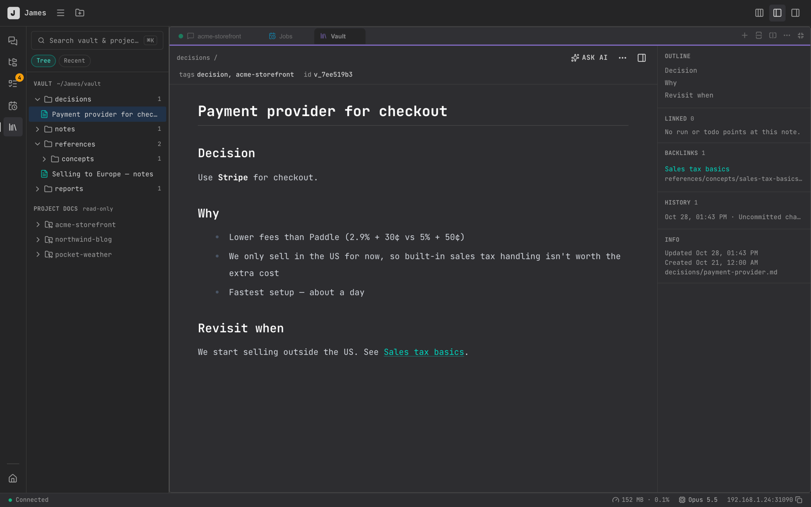

# Vault

The Vault is your knowledge base: notes, references, decisions and reports that every session and project can use. Claude writes to it, searches it and reads it, so what one session learns, the next one can find.

Open it from the **Vault** icon in the sidebar, or **More → Vault** on mobile.

## Where it lives

The Vault is a folder of Markdown (and HTML) files at `~/James/vault`. You can open it in any editor, or point James at another folder in **Settings → Vault → Folder** (existing files aren't moved).

It's also a git repository. James commits changes automatically a couple of minutes after they're made, and keeps the last 20 versions of each note. To back it up, set a remote in **Settings → Vault → Backup**; James pushes to it daily.

## Browsing

- **Tree** and **Recent** views on the left, with your Vault and a read-only **Project docs** section (the docs folders of your projects).
- **Search** (⌘K on the Vault page) looks through titles, text and tags across the Vault and every project's docs.
- The info panel shows the note's **Outline**, **Backlinks** (notes that link here), **Linked** runs and todos, and **History**.
- **⋯** copies a note's `[[link]]`, path or id.

Notes link to each other with `[[wiki links]]`. Every note has a permanent id, so links keep working after you move or rename it.

## Changing notes

In James you change notes by asking Claude: open a note, click **Ask AI**, and say what to change. (You can also edit the files directly in any editor.)

Claude never deletes notes — it archives them. Every change is versioned, so nothing is lost.

## How Claude uses it

From any session, Claude can save, search, read, update and move notes:

> "Research MCP auth patterns and save a summary to the Vault under references."
>
> "What did we decide about the database schema last month? Check the Vault."
>
> "Add today's findings to my notes on the payment bug."

When Claude saves research material, it can also link it to **concept pages** — one page per idea, under `references/concepts/` — so related sources gather in one place.

[Jobs](./jobs.md) can save each run's result to the Vault, and [Todos](./todos.md) can attach notes.
